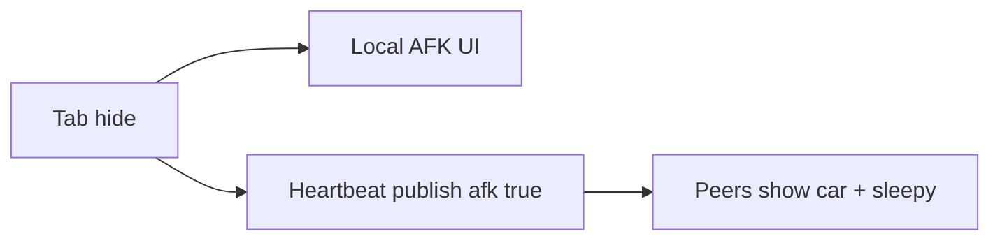

# AFK presence + richer remote police

Target: [`PragueGTA`](PragueGTA) on a **new branch from `main`** (multiplayer already merged). Demo room stays default for now.

## Problem today

Tab hide/blur → `setPaused(true)` → [`session.step`](PragueGTA/src/net/session.js) **stops publishing** → peers cull after [`STALE_MS` = 8s](PragueGTA/src/net/protocol.js). Remotes already draw chase **cars** only — no siren, no foot cops, no arrest scene.

## 1. AFK: stay online + 😴

**Intent:** Local AFK screen stays. Do **not** drop the player from `demo`. Mark remotes with 😴 while AFK. Floor: presence held for **at least 1 minute** after AFK starts (via heartbeat + raised stale window while `afk`).

| Change | Detail |
|--------|--------|
| Protocol | Add `afk: boolean` (and `afkSince` ms) to `buildPresence` / parsers |
| Session | When paused for visibility/blur AFK: still **heartbeat** publish (~1 Hz) with last pose + `afk: true`; keep listening/updating remotes |
| Stale | While `afk`, peers treat stale as **≥60s** (or always refresh `updatedAt` on heartbeat so 8s cull never fires) |
| Remote UI | In [`remote-presence.js`](PragueGTA/src/net/remote-presence.js) name label: prefix/replace with 😴 when `afk` |
| HUD | No change required to local AFK screen |

Do **not** rely on removing `onDisconnect` — closed tab still clears the row. Bust/pause from arrest is separate: keep publishing arrest state (below) instead of freezing the row.

## 2. Remote police: sound + officers + arrest

Extend presence so watchers hear and see the mayhem.

**Payload** (from local `police.snapshot()` + roadblock/finale when active):

- Keep cars: `police[]` with pose/role
- Add `officers[]`: `{ id, x, z, heading, pose }` when foot cops exist (cap similarly)
- Add `arrest`: `{ active, phase, t }` or reuse `wanted.busted` + enough pose data to drive a short remote arrest scene
- Ensure **bust moment still publishes** (do not gate `publishPlayer` off solely because `busted` paused the sim frame)

**Remote render / audio** in [`remote-presence.js`](PragueGTA/src/net/remote-presence.js) (+ thin helpers if needed):

| Feature | Reuse |
|---------|--------|
| Siren for remote chase | [`createSiren`](PragueGTA/src/police-siren.js) / `sirenMix` driven by remote units + local listener; respect sound toggle; skip when local tab AFK if audio policy requires |
| Car strobes | Patterns from [`police-renderer.js`](PragueGTA/src/police-renderer.js) on remote meshes |
| Foot officers | [`officerLook`](PragueGTA/src/roadblock.js) / person batch like local roadblock |
| Arrest | Lightweight remote scene from published `arrest` / `busted` — mirror `startArrest` poses without owning the local finale camera |

## 3. Crash other players' cars

Remotes in [`src/net/remote-presence.js`](PragueGTA/src/net/remote-presence.js) are visual-only. NPC hits already go through `ImpactSystem.collide` in [`src/impacts.js`](PragueGTA/src/impacts.js) and `crashImpulse` in [`src/crash-physics.js`](PragueGTA/src/crash-physics.js).

- Expose remote cars (car mode only) as bodies in the vehicle list passed to `impacts.collide`.
- On hit, if the other body is remote: dent the local car, apply `crashImpulse` locally, and publish a small impulse (`uid`, direction, speed). Do not call `Mobility.knock`.
- The other client applies that impulse to its own car (shove + spin, same crash helper). Their mesh then publishes the new pose, so it does not lerp straight back through the hit.
- No host, no mutual collider authority beyond that impulse.

## 4. Steal a police car, H siren, Tab HUD

Today [`PlayerTravel.interact`](PragueGTA/src/player-travel.js) (`F` / `Enter`) only enters stopped traffic and parked cars. Police units are obstacles and are not enterable. [`KeyH`](PragueGTA/src/main.js) toggles `clean-capture`. The page starts compact: [`index.html`](PragueGTA/index.html) has `<body class="booting clean-capture">`.

- Add a stopped police unit to the enter list. Claim it (`playerTaken`, leave the chase). Render the player car with `createPoliceBody`, not a civilian mesh.
- **H** toggles the siren only while driving that stolen police car. Reuse [`createSiren`](PragueGTA/src/police-siren.js) and the light-bar strobes. H does nothing else.
- **Tab** toggles show/hide extra HUD (`clean-capture`), replacing H. On the BUSTED screen, Tab still moves between the two buttons.
- **Extended HUD is the default:** drop `clean-capture` from the initial body class so the full HUD (street, controls hint, top bar, location) is visible on load. Tab still hides it for a clean capture.
- Help grid in [`index.html`](PragueGTA/index.html): "Show / hide extra HUD" becomes `Tab`. Add "Siren (stolen police car)" as `H`.

## 5. Tests + ship

- Protocol tests: `afk` parse; heartbeat fields; officers/arrest schema; crash impulse parse
- Feature branch from `main` → PR → Heroku review deploy
- Manual: two tabs — hide one at least 1 min, other still sees the sleepy car; raise wanted on A, B hears siren and sees officers/arrest; A rams B and B's car is shoved; A takes a police car, H starts the siren, Tab hides the extra HUD; fresh load shows the extended HUD

## Out of scope

- Reverting anonymous auto-join (leave as-is until you ask)
- Full shared physics or a host
- Changing the demo room id
