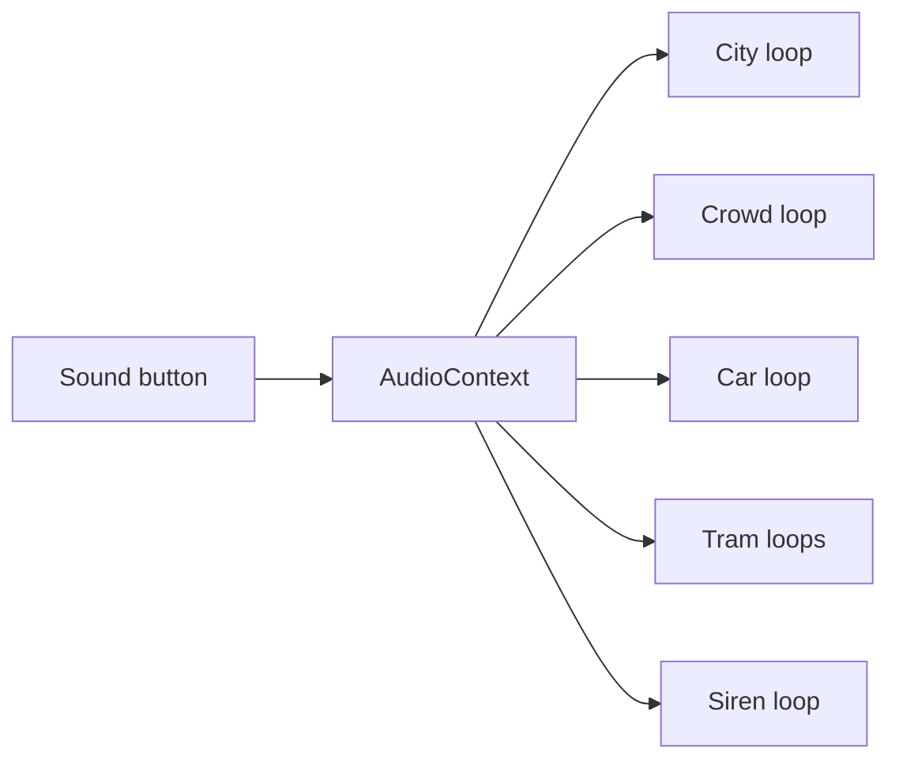

# Real city sounds

Sound is already a toggle in the menu. Turning it on today starts a triangle-wave hum for the player car ([src/main.js](PragueGTA/src/main.js) around the `sound-btn` handler and the frame update near line 776), a sawtooth siren ([src/police-siren.js](PragueGTA/src/police-siren.js)), and synthesised gull calls. Dialogue stays on the browser’s speech voices.

[src/audio-math.js](PragueGTA/src/audio-math.js) already computes what a soundscape should do: engine hum versus speed, cobblestone rumble versus asphalt, distance fade, stereo pan, city and crowd levels, and a tram bell when a tram leaves a stop. [docs/IDEAS.md](PragueGTA/docs/IDEAS.md) says the missing piece is `src/audio.js`, and that samples must be CC0 or CC BY and listed in `NOTICE.md`.

## Recordings

Download from [BigSoundBank](https://bigsoundbank.com) (La Sonothèque). Those clips are real recordings, CC0, and the licence explicitly allows editing and shipping them in a game with no account. Freesound needs a login, and several other “free” banks are non-commercial, so they stay out.

| Role | Clip | Use |
| --- | --- | --- |
| City | Street and roads, s0608, or the Levallois crossing if the shorter street bed is too thin | Quiet loop everywhere |
| People | Lourdes pedestrian street, s2676 | Loop, louder when pedestrians are nearby |
| Car | A steady car or electric-vehicle interior from the same bank, chosen by listening so it loops | Player car; playback rate follows speed |
| Tram roll | Tram passing, s3372 | Loop on the nearest moving trams |
| Tram departure | Tram starts and departs, s3538 | One-shot when a tram leaves a stop |
| Police | French two-tone outdoor siren, s0886 | Loop while a unit is in range |

Trim each loop to a few seconds that does not click, encode to MP3 around 128 kbps, and commit only those excerpts under `public/sounds/`. Full 24-bit WAVs stay out of git. `public/sounds/sources.json` records the page URL, author, and CC0 for each file. Add the same credit to [NOTICE.md](PragueGTA/NOTICE.md). Attribution is not required by CC0; the game’s Sources habit is to keep it anyway.

## Playback

New [src/audio.js](PragueGTA/src/audio.js) attaches to the `AudioContext` the sound button already creates. It does not start audio until that button is on, and it goes silent when the game is paused or the map is open, matching `mixerGains` in `audio-math.js`.

- City gain follows `ambienceMix().city`.
- Crowd gain follows how close the nearest pedestrians are (`nearestSources`).
- The triangle oscillator goes away. Car gain and playback rate come from `engineModel` and `rollingMix`, so cobblestones (`Nupukivi`, already what Prague setts map to) rumble more than asphalt.
- Up to three nearby trams get a positional roll. `tramDepartures` fires the departure clip once.
- The siren sample replaces the sawtooth inside `createSiren`. Volume still comes from `sirenMix`, so distance falloff and the existing siren tests stay. The recording already contains the two-tone, so the oscillator sweep is not layered on top.
- Gull calls and spoken dialogue stay as they are.

This is shared engine behaviour, so Helsinki and Tampere get the same beds. Work stays on `city/prague` in the PragueGTA checkout.

## Check

Unit-test only the pure mapping from speed and surface to playback rate and gain. Then, in the browser with sound enabled: a city bed at the start, the car rising as it pulls away on Divadelní, a tram near the embankment, crowd murmur among pedestrians, and a siren once police are in pursuit.
