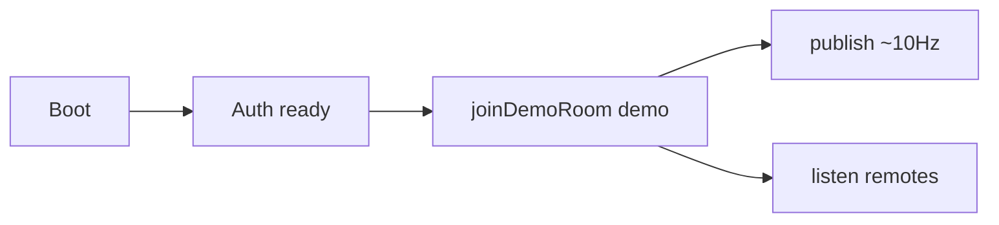

# Default demo-room multiplayer (temp)

## Clarification

There is **no anonymous room**. Today:

- **Solo (default):** no RTDB join — what you get until you opt in
- **`demo`:** the only shared room (`gta-praha/rooms/demo/players`)

So “default to demo” means **auto-join on load**, not picking a different room id.

Yes — make join default for now. To make simulation easy (two tabs, no Google), allow **anonymous** into `demo` temporarily. Google-only auto-join still needs a popup per browser and is why testing feels stuck.

## Where to change

Branch: `feature/gta-praha-multiplayer` in [`PragueGTA`](PragueGTA) (PR [#12](https://github.com/smarlify/gta-prague/pull/12)). Not on `city/prague-expand` / `feature/high-score`.

| File | Change |
|------|--------|
| [`src/net/protocol.js`](PragueGTA/src/net/protocol.js) | Relax `canJoinMultiplayer` so anonymous/guest uids can join (keep requiring a uid) |
| [`src/net/session.js`](PragueGTA/src/net/session.js) | On auth ready / boot: auto `joinDemoRoom` when configured; stop “do not auto-join” behavior |
| [`src/net/room.js`](PragueGTA/src/net/room.js) | `goOnline`: join with current user; do not force Google for the temp default |
| [`src/net/online-hud.js`](PragueGTA/src/net/online-hud.js) | Label as Online · N / “Go offline” (toggle to leave); no “must Go online first” |
| [`database.rules.json`](PragueGTA/database.rules.json) | Allow any authenticated uid (incl. anonymous) read/write own `players/$uid` under demo |
| [`tests/net-protocol.test.mjs`](PragueGTA/tests/net-protocol.test.mjs) | Flip anonymous-gate expectations to match temp policy |

## Ship

1. Commit on `feature/gta-praha-multiplayer`
2. Push, update PR #12
3. Publish updated RTDB rules to the scoreboard Firebase project (required or anonymous writes fail)
4. `git push heroku HEAD:main` so review host picks up auto-join

## Revert later

When done testing: restore Google-only gate + opt-in HUD, tighten rules again. Keep `DEMO_ROOM = 'demo'` as the single room.
