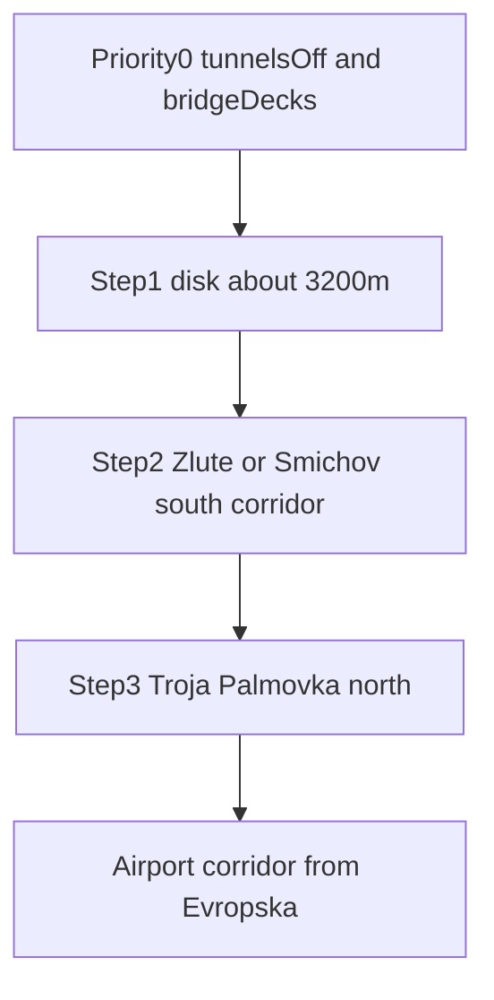

# Extended Prague (district expansion)

Target repo: [`PragueGTA`](PragueGTA) (`smarlify/gta-prague`). Branch: **`city/prague-expand`** from `origin/main`. Do **not** mix this with `feature/gta-praha-multiplayer`. Never commit on `main`. Never force-push.

Authoritative ask (14 Oct): named districts below, **remove all tunnels**, **fix bridges first**, light landmarks/scenery within FPS budget, grow stepwise (never one 6 km Overpass wipe). Older [`prague_roads_and_river`](PragueGTA/.cursor/plans/prague_roads_and_river_fc46a10b.plan.md) “keep tunnels” guidance is **superseded** by the tunnels-off requirement.

WIP already exists as `stash@{0}` (`prague-expand-wip-before-multiplayer`) with `radiusMetres: 3200` and new starts. Restore that onto `city/prague-expand` (or cherry-pick the useful parts) after multiplayer no longer owns the working tree; do not discard the staged building/surface packs without checking they still load.

## Geography (from Staroměstské origin `14.42125, 50.08747`)

Current live disk: **2400 m**. Measured targets:

| Place | ≈ m | Inside 2400? | Step |
| --- | ---: | --- | --- |
| Nuselský most, Anděl, Karlínské nám., Vltavská, Výstaviště | ~1.8–2.3 km | yes | polish / already in |
| Vyšehrad, Nádraží Holešovice, Invalidovna, Smíchovské nádraží, Podolská vodárna | ~2.6–3.1 km | no | **Step 1 (~3200 m)** |
| Žluté lázně, Lihovar → Barrandovský most | ~3.5–5.2 km | no | Step 2 / south corridor |
| Troja, zoo, botanic, Palmovka, Kobylisy, Bohnice | ~3.5–5.2 km | no | Step 3 / north |
| PRG airport (Evropská) | ~11.4 km | no | **Airport corridor last** |

## Priority 0 — Driveability (same PR as Step 1)

1. **Tunnels off.** Extend the bored-tunnel strip so every Prague underground `passage` / tunnel / `building_passage` / covered bore is removed from roads and mobility at load. Surface streets only. No underground collision, no driveable bores.
2. **Bridges (highest priority).** No phantom mid-deck collisions; decks fully driveable; look like deck + structure, not a terrain sand-bank across the Vltava. Prioritize Legií, Mánes, Nuselský, Hlávkův, Jiráskův, Palackého in the Step 1 disk. Use/fix passage-deck / bridge meshing ([`src/prague-scenery.js`](PragueGTA/src/prague-scenery.js), terrain stamps in [`scripts/city-terrain.mjs`](PragueGTA/scripts/city-terrain.mjs)). Barrandov waits for its corridor.
3. **Landmarks (light).** Karlův most as scenic/pedestrian mesh if cheap; cars stay on embankments.
4. **Scenery.** Extra park trees only where parks exist, capped; reuse existing species / CC0 textures. No new photo-façade atlases in this PR.
5. **Performance.** Prefer the modest Step 1 disk over a 5–6 km rebuild. Cap trees; avoid huge atlases; note FPS if the radius bump hurts — further growth = corridors ([`scripts/prague-corridors.mjs`](PragueGTA/scripts/prague-corridors.mjs)).

## Step 1 — Ship this PR

- Set [`cities/prague/city.json`](PragueGTA/cities/prague/city.json) `radiusMetres` ≈ **3200** and note covering Vyšehrad, Nuselský most, Podolská vodárna, complete Holešovice, Karlín through Invalidovna, Smíchovské nádraží.
- Rebuild using **cached** Overpass when possible; **stage** packs under `data/raw/cities/prague/stage` before swapping `public/cities/prague`. On Overpass failure, restore the last good pack — never leave a wiped city.
- Re-run terrain (and IPR buildings as needed for the new ring) after the swap.
- Update `PRAGUE_AREAS` / starts / district labels for newly reachable places ([`src/area-caption.js`](PragueGTA/src/area-caption.js)).

## Later steps (do not bake in this PR)

- **Step 2:** Žluté lázně tip and/or Smíchov → Lihovar → Barrandovský most as a **corridor**.
- **Step 3:** Troja (+ zoo/botanic), Palmovka; Bohnice / Kobylisy only after pack-size check.
- **Last:** Dejvice (Evropská) → Václav Havel Airport as a buffered corridor — never an 11 km disk.

## Docs and ship

- Keep / refresh [`PragueGTA/.cursor/plans/prague_district_expansion.plan.md`](PragueGTA/.cursor/plans/prague_district_expansion.plan.md) with the distance table (restore from stash if missing on disk).
- Commit on `city/prague-expand` (Gitmoji OK), push, open PR against `main` (**do not merge**), deploy `git push heroku HEAD:main` for playtest if the slug still fits.
- Hooks on; no secrets; no Kaloko from the laptop.
- Keep every committed file under 100 MB; thin walking edges/trees outside the old core if `mobility.json` approaches ~90 MB.

## Acceptance (Step 1 PR)

1. No underground tunnel segments remain driveable or colliding in Prague.
2. Named Vltava bridges in the disk are driveable and read as bridges, not sand-banks.
3. Player can reach Vyšehrad, Podolská vodárna, Nádraží Holešovice, Invalidovna, Smíchovské nádraží from the origin without falling off the playable edge.
4. District labels/starts name the new places; Heroku review build boots.
