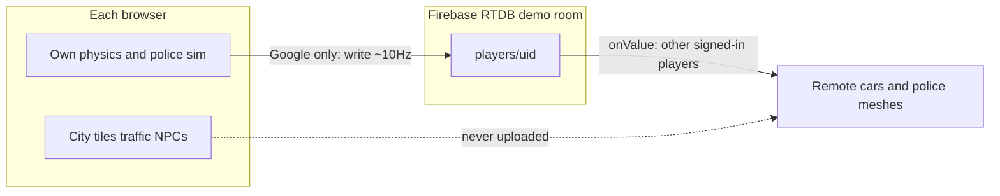

# GTA Praha multiplayer (demo room)

Shipped: demo-room presence is on origin/main (https://github.com/smarlify/gta-prague/pull/12).

Target repo: [`PragueGTA`](PragueGTA) (`smarlify/gta-prague`). Do this on a **new feature branch from `origin/main`**, not on the current `city/prague-expand` district work.

## What stays local vs what is shared

- **Local forever:** streamed Prague, NPC traffic, trams, pedestrians, your own physics. Matches “everything is generated to you.”
- **Shared only when signed in with Google:** your presence row in one room `demo`.
- **Anonymous:** no RTDB join, no remote listeners. Gameplay stays exactly as today.
- **Remotes are visual presence** in v1: render other players and their published police units. No mutual collision, no shared world authority, no host election (unlike Marooned’s loot host).

## Auth gate

Reuse existing Google + `smarlify-api` auth in [`src/firebase.js`](PragueGTA/src/firebase.js) / [`src/high-score.js`](PragueGTA/src/high-score.js).

- Mid-session Google sign-in **enables** multiplayer (join `demo`, start publishing and listening).
- Sign-out or anonymous → leave the room, clear remotes, stop writes.
- Add a small HUD control (“Go online” / online count) near the existing high-score Google path; do not force sign-in to play.

## Firebase backend

- **Project:** keep Auth + Firestore scores on `smarlify-api`. Add **Realtime Database** (EU) for presence. Env: `VITE_SCOREBOARD_*` plus `VITE_SCOREBOARD_DATABASE_URL` (or a clearly named `VITE_MULTIPLAYER_DATABASE_URL` that points at the same app).
- **Why not a new project:** one Google popup already used for scores; linking two Firebase apps is worse UX for v1.
- **Rules** (new `database.rules.json` for this DB, published separately from Marooned):
  - Path shape: `gta-praha/rooms/demo/players/$uid`
  - Read: any authenticated non-anonymous user
  - Write: only `auth.uid === $uid`, and only if `!auth.token.firebase.sign_in_provider.contains('anonymous')` (or equivalent provider check)
  - `onDisconnect` removes the player row
- Do not put Marooned’s island schema here. Do not use `grand-island-survival`.

## Presence payload (published ~10 Hz, throttle like Marooned `PLAYER_HZ`)

Driven from existing state already available in-game:

From travel / car ([`src/player-travel.js`](PragueGTA/src/player-travel.js), [`src/main.js`](PragueGTA/src/main.js)):

- `x`, `z`, `heading`, `speed`
- `mode`: `car` | `walk` | `bike` | `scooter`
- `vehicle`: `{ type, colour }` when in a car (from player car renderer / vehicle model userData); omit or null on foot
- `name`: Google display name
- `updatedAt`: server or client timestamp for stale cull

From `police.snapshot()` in [`src/police.js`](PragueGTA/src/police.js) (already returns level, heat, status, units):

- `wanted`: `{ level, heat, status, busted }`
- `police`: array of `{ id, x, z, heading, speed, role }` — **only when `level > 0`**, capped (e.g. max 12 units) so the far-away mayhem is visible without flooding RTDB
- When clear: omit `police` / write empty so remotes despawn chase cars

Each client remains authoritative for **its own** police simulation. Remotes do not re-simulate another player’s chase; they only draw the published units.

## Client modules (new, Marooned-shaped but thinner)

Add under `src/net/` (names indicative):

- `protocol.js` — presence schema + parsers
- `room.js` — join/leave `demo`, `publishPlayer`, `onValue` remotes, `onDisconnect`
- `firebase-rtdb.js` — `getDatabase` beside existing Auth/Firestore helpers
- `remote-presence.js` — spawn/update/dispose remote player meshes (reuse vehicle models / person from existing renderers where cheap) and remote police meshes (reuse police renderer patterns from [`src/police-renderer.js`](PragueGTA/src/police-renderer.js) if practical)

Wire from [`src/main.js`](PragueGTA/src/main.js) after the car/police step: if online, publish snapshot; each frame, lerp remotes toward latest net pose.

## Out of scope for this pass

- Multiple rooms / room picker (only `demo`)
- Host-authoritative world, loot, or shared traffic
- Player-vs-player collision or shooting
- Territories / owned corners (VISION.md future)
- Upstream Worldhood issue #22 relay server — we use Firebase RTDB instead
- Kaloko multiplayer scenarios (optional later)
- Merging or blocking the separate Prague district expansion branch

## Docs / ship notes

- Update [`README.md`](PragueGTA/README.md) one line: signed-in players share presence in `demo`; city still runs locally.
- Tests: pure protocol parse/serialize + “anonymous does not write” unit tests under `tests/`.
- Ship: feature branch, PR, Heroku review deploy — same as other games. Secrets only in Heroku/GitHub env, never committed.

## Acceptance

1. Anonymous session: alone, no remotes, no RTDB writes.
2. Two Google-signed browsers on `demo`: each sees the other’s car/ped and pose updating smoothly.
3. One player raises wanted stars and gets police: the other sees stars (or clear wanted cue) and police cars in the distance matching the publisher’s units.
4. Disconnect or sign-out: presence row clears; remotes disappear.
