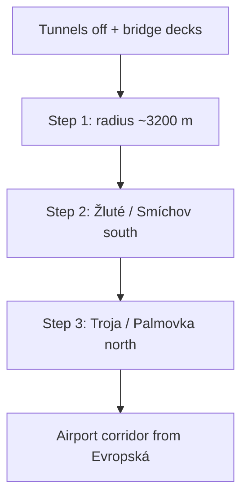

# Prague district expansion

Origin: Staroměstské náměstí `[14.42125, 50.08747]`. Playable radius **3200 m** (Step 1 shipped). Grow stepwise; stage under `data/raw/cities/prague/stage` before swapping `public/cities/prague`. A failed Overpass must not delete the last good packs.

## Distance table (local metres ≈ haversine)

| Place | ≈ m from origin | Inside 2400? | Target step |
| --- | ---: | --- | --- |
| Nuselský most | 2318 | yes | Step 1 (already in) |
| Smíchov (Anděl) | 2116 | yes | already in |
| Karlín (Karlínské nám.) | 1960 | yes | already in |
| Holešovice (Vltavská) | 1820 | yes | already in |
| Holešovice (Výstaviště) | 2207 | yes | already in |
| Vyšehrad | 2581 | no | **Step 1** |
| Holešovice (Nádraží) | 2826 | no | **Step 1** |
| Karlín (Invalidovna) | 3019 | no | **Step 1** |
| Smíchovské nádraží | 3045 | no | **Step 1** |
| Podolská vodárna | 3117 | no | **Step 1** |
| Žluté lázně | 3453 | no | Step 2 / south tip |
| Pražská zoo | 3461 | no | Step 3 |
| Lihovar | 3923 | no | Step 2 corridor |
| Troja (zámek) | 3936 | no | Step 3 |
| Palmovka | 4142 | no | Step 3 |
| Botanická zahrada | 4372 | no | Step 3 |
| Kobylisy | 4624 | no | Step 3+ |
| Barrandovský most | 5188 | no | tunnel/Barrandov corridor |
| Bohnice | 5242 | no | Step 3+ |
| PRG airport | 11406 | no | **Airport corridor last** |

## Ordered playable steps

### Priority 0 — Driveability (same PR as Step 1)

1. **Tunnels:** Extend the bored-tunnel strip so **all** `passage` roads and mobility edges through them leave Prague. Surface streets only. No underground collision, no passage decks for bores.
2. **Bridges:** Highest priority. Terrain must not blend bridge height into water cells (that reads as a sand-bank). Keep a thin stamped deck for driving; add a light deck + pier + rail mesh for Vltava bridges (Legií, Mánes, Nuselský, Hlávkův, Jiráskův, Palackého, …). Barrandov waits for its corridor. No invisible building solids on asphalt (`roadClearsBuildings` stays).
3. **Landmarks (light):** Karlův most as scenic/pedestrian landmark if cheap; car traffic stays on parallel embankments.
4. **Scenery:** Extra park trees only where parks exist, capped; reuse species. No new photo-façade atlases in this PR.
5. **Performance:** Prefer this modest disk over a 5–6 km rebuild. Trees remain cropped to the 2 km walk core in the bake; hand scenery stays small. Further growth = corridors.

### Step 1 — Inner south + complete Holešovice (~3200 m)

Smallest next circle that takes the user’s near list without Žluté tip, Barrandov, Troja, or the airport:

- Vyšehrad, Nuselský most, Podolská vodárna
- Complete Praha 7 Holešovice (incl. nádraží)
- Karlín through Invalidovna; Smíchovské nádraží
- Rebuild from **cached** Overpass when possible (`npm run city:build -- prague` without `--refresh`); stage then swap
- Then `city:terrain` so bridge stamps match the new extent
- Update `PRAGUE_AREAS` + starts

### Step 2 — South tip / Smíchov chain

Žluté lázně (~3.45 km) and Smíchov → Lihovar → toward Barrandovský most as a **corridor** (or a tiny further radius bump only if packs stay under GitHub limits).

### Step 3 — North / east

Troja (+ zoo & botanic), Palmovka; Bohnice and Kobylisy only after measuring pack size.

### Last — Airport corridor

Dejvice (Evropská) → Václav Havel Airport via `prague-corridors` / buffered strip. Never a disk to 11 km.

## Ship rules

- Branch `city/prague-expand` (not `main`, not `worldhood` branding changes)
- Commit, push, open PR, deploy Heroku for playtest; do not merge until asked
- Hooks on; no secrets
