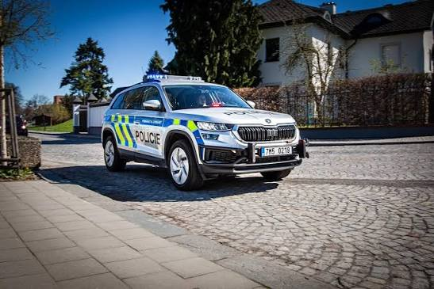
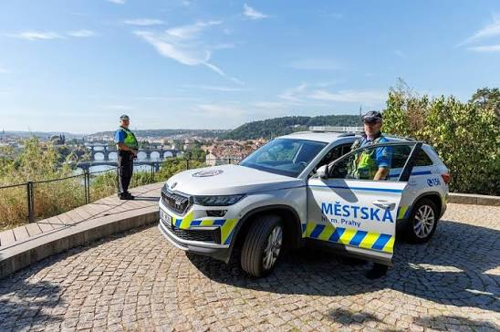
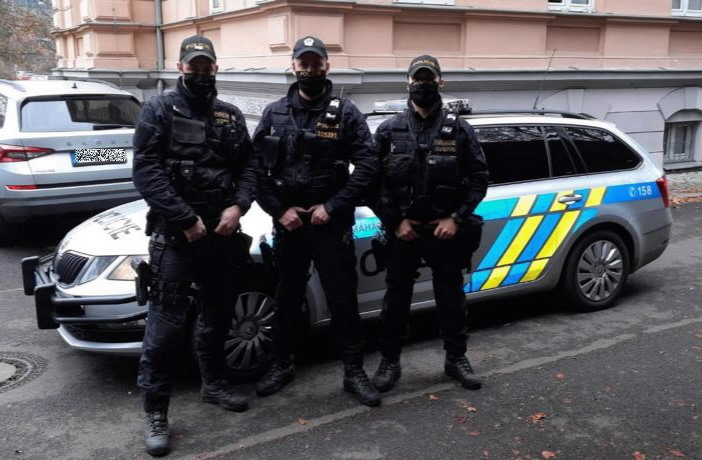

# Prague districts and Czech police labels

## Summary

Nearest-anchor district captions (`Praha N - Neighbourhood`), Czech police lettering (Policie vs Městská policie by wanted level), more starts with a Praha N selector, and a modest playable radius so Dejvice’s Vítězné náměstí (Kruháč) is inside the disk.

## Districts

- `PRAGUE_AREAS` in `src/area-caption.js` (Helsinki-style anchors).
- Minimap caption and `#district-label` both come from `areaCaption`.
- Starts in `cities/prague/city.json` carry `district`; `city-build.mjs` uses `s.district ?? def.name`.

## Police

- `policeAgencyFor(cityId, level)` in `src/czech-fleet.js`
  - Prague, wanted ≤ 2 → Policie / `praha`
  - Prague, wanted ≥ 3 → Městská policie / `praha-mestska`
  - else Finnish POLIISI / `fi`
- Cars: `police-model.js` + livery at spawn in `police-renderer.js`
- Officers: jacket/vest word from the agency in `person-model.js` / `roadblock.js`

## Extent (Dejvice Kruháč)

- Origin `14.42125, 50.08747` → Vítězné náměstí ≈ **2360 m**
- `radiusMetres` raised **2000 → 2400** (smallest step that includes the roundabout)
- No full Overpass rebuild: roads and graph already covered the download edge past Kruháč; only radius + landmarks were patched in `city.pack` / `index.json`

## Starts UI

- Extra starts across Praha 1, 2, 5, 6, 7, 8
- Boot card: ‹ Praha N › district row filters the place picker

## Favicon

- `public/favicon.svg` is the Czech flag (white / red / blue triangle)
- `updateWorldhoodBrand` no longer replaces the tab icon with the globe mark; title stays `GTA Praha 🚔`

## Reference photos

