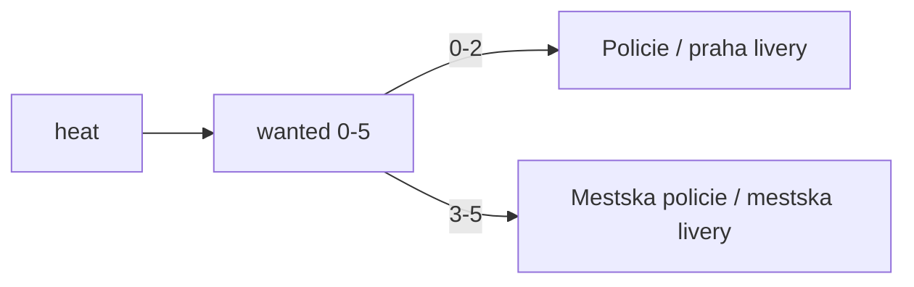

# Prague districts and Czech police labels

## Context

- Minimap caption comes from [`src/area-caption.js`](PragueGTA/src/area-caption.js): when the nearest place’s `district` equals the city name, it prints `PRAHA CENTRE`.
- HUD `#district-label` uses the nearest landmark’s `district` ([`src/main.js`](PragueGTA/src/main.js) ~715). Every Prague landmark is currently `district: "Praha"` because [`scripts/city-build.mjs`](PragueGTA/scripts/city-build.mjs) always copies `def.name`.
- Helsinki already uses sparse area anchors (`HELSINKI_AREAS`) for the same minimap path; Prague will mirror that.
- Praha car livery already draws `POLICIE` via `policeLiveryFor('prague')` → `'praha'`. Officer jackets/vests still hardcode `POLIISI` in [`src/person-model.js`](PragueGTA/src/person-model.js). Wanted stars are 0–5 in [`src/police.js`](PragueGTA/src/police.js); there is no agency split yet.

Reference photos (copy into plan assets): state Policie Kodiaq / tactical Policie, and white Městská policie (Letná / Praha 7).

## 1. District labels (automatic by position)

Add `PRAGUE_AREAS` in [`src/area-caption.js`](PragueGTA/src/area-caption.js) — game-frame metres relative to the city origin in [`cities/prague/city.json`](PragueGTA/cities/prague/city.json) (`14.42125, 50.08747`), same pattern as `HELSINKI_AREAS`.

Label format: `Praha N - Neighbourhood` (examples: `Praha 1 - Staré Město`, `Praha 2 - Nové Město`, `Praha 7 - Holešovice`, `Praha 6 - Dejvice`, plus Malá Strana, Josefov, Karlín, Smíchov, Letná, Vinohrady as needed for the 2 km disk).

Wire in [`src/main.js`](PragueGTA/src/main.js) (~870):

```js
areaLabel = areaCaption(
  city.id === 'prague' ? [...PRAGUE_AREAS, ...data.landmarks]
    : helsinki ? [...HELSINKI_AREAS, ...]
    : data.landmarks,
  city.name
);
```

Drive both the minimap caption and `#district-label` from `areaLabel` so they stay in sync (stop using raw `nearest.district` for Prague / generally once areas exist).

Also set `district` on each `starts[]` entry in `city.json` and teach city-build to use `s.district ?? def.name` so rebuilt landmarks are correct without relying only on the runtime table.

No Overpass admin fetch for this step (avoids transit/areas 504 risk). Nearest-anchor naming matches Helsinki and is enough for the 2 km city.

## 2. Police: Policie vs Městská policie



- Add `policeAgencyFor(cityId, level)` in [`src/czech-fleet.js`](PragueGTA/src/czech-fleet.js):
  - non-Prague → Finnish (`POLIISI`, `fi`)
  - Prague, level ≤ 2 → `{ word: 'POLICIE', uniform: 'Policie', livery: 'praha' }`
  - Prague, level ≥ 3 → `{ word: 'MĚSTSKÁ', uniform: 'Městská policie', livery: 'praha-mestska' }`
- [`src/police-model.js`](PragueGTA/src/police-model.js): add `praha-mestska` atlas (white body, blue `MĚSTSKÁ` door text, keep yellow/blue chevrons; door word from agency). Keep `praha` as state Policie (silver/grey + `POLICIE`). Fix any leftover hardcoded FI `POLIISI` on rear/bar paths so they use `spec.word`.
- [`src/police-renderer.js`](PragueGTA/src/police-renderer.js): when creating a unit mesh, pick livery from `policeAgencyFor(cityId, simulation.level)` at spawn time (units keep the agency they spawned with).
- [`src/person-model.js`](PragueGTA/src/person-model.js) / roadblock: pass city + agency into the police person batch so jackets/vests print `Policie` or `Městská policie` instead of `POLIISI` (two texture sets or regenerate when agency changes). Finnish cities unchanged.

Wanted HUD English strings (`POLICE PURSUIT`, etc.) stay as-is unless we localize later.

## 3. Plan file and assets

- Copy the three user photos into [`PragueGTA/.cursor/plans/assets/`](PragueGTA/.cursor/plans/assets/) with clear names (`policie-kodiaq.jpg`, `mestska-policie-letna.jpg`, `policie-tactical.jpg`).
- Write [`PragueGTA/.cursor/plans/prague_districts_and_police.plan.md`](PragueGTA/.cursor/plans/prague_districts_and_police.plan.md) linking those assets and summarizing this work (same style as existing plans in that folder).

## 4. Ship

On `city/prague-wide`: implement, smoke locally (drive across districts; raise wanted past 3 and confirm lettering), commit, push, update [PR #6](https://github.com/smarlify/gta-prague/pull/6), deploy `git push heroku HEAD:main`. No Kaloko from laptop; hooks on.
