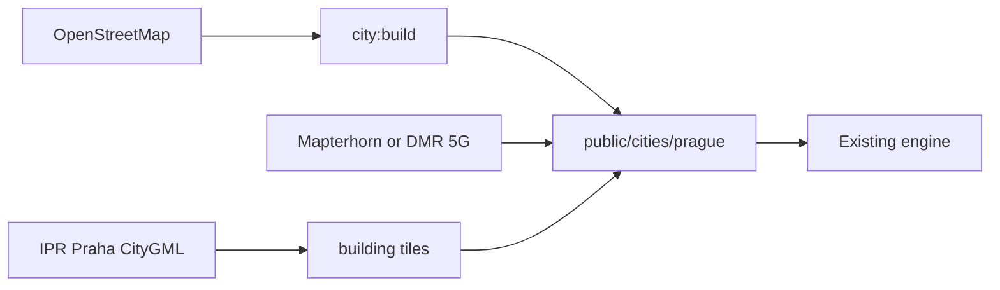

# A Prague driving game on this engine

The folder [PragueGTA](PragueGTA) is a browser city playground (Three.js + Vite, MIT). There is no Prague content in it. Helsinki is the finished city. Tampere is the proof that any city can be built from OpenStreetMap and left as a draft.

[smarlify/worldhood](https://github.com/smarlify/worldhood) is a fork of [worldhood/worldhood](https://github.com/worldhood/worldhood), and `main` is the same commit as this checkout (`4db4f0a`). No reclone and no rebase. When the work starts:

- Keep this folder. Add `smarlify/worldhood` as the push remote (leave `worldhood/worldhood` as the upstream fetch remote).
- Do the Prague data on a `city/prague` branch and open the pull request on the smarlify fork. Do not open it against `worldhood/worldhood`.

You do not port an engine into a new game. You add a city pack. Driving, traffic, trams, cameras, and streaming stay as they are.

## What you get from OpenStreetMap

Yes. OSM is the supported path, and Prague is one of the better-mapped cities in Europe (footprints, heights, one-ways, cobbles, a dense tram network).

The playbook in [docs/BUILD_YOUR_CITY.md](PragueGTA/docs/BUILD_YOUR_CITY.md) is:

```sh
npm run city:new   -- prague "Prague, Czech Republic" 2000
npm run city:build -- prague
npm run dev
# open http://localhost:5173/?city=prague
```

`city:build` ([scripts/city-build.mjs](PragueGTA/scripts/city-build.mjs)) downloads Overpass data and writes the same files Helsinki uses:

- Buildings extruded from footprints (`height` or `building:levels`, else a type default, capped at 120 m)
- Roads buffered from centrelines; `surface=sett` and `cobblestone` already rumble (mapped to the Finnish material name `Nupukivi`)
- Water, parks, trees
- A car graph that respects one-ways and `motor_vehicle=no`, plus traffic lights
- Tram and bus lines from OSM `route=tram|bus` relations
- Terrain from Mapterhorn at the end of the build (hills, bridges, the Vltava levelled)

Coordinates are local metres, X east and Z south, from a transverse Mercator on the city’s origin. Prague does not need a new coordinate system.

Licence: OSM is ODbL. Keep the attribution. Do not trace Google Street View or Google 3D tiles into the game; the project’s own guide forbids that.

The playable area is a circle, 1.5–2 km in the existing cities. A 2 km circle centred on Old Town Square covers the castle, Malá Strana, Old Town, most of New Town, and the near embankments. Vyšehrad, Žižkov, and Vinohrady sit on the edge or outside. The whole of Prague (about 500 km²) is not a single map in this engine. Extra districts are added later as extensions, the way Espoo is added onto Helsinki.

Pedestrian streets (`highway=pedestrian`: Karlův most, Karlova, Celetná) are pavement, so AI traffic will not route along them. The player car can still drive on pavement, which is fine for a playground and wrong if you want traffic rules.

## What OSM will not give you

The project’s own bar, in [docs/RECOGNISABILITY.md](PragueGTA/docs/RECOGNISABILITY.md): OSM is the skeleton. A first build looks like Tampere: grey boxes, roughly right streets, real tram lines, flat-ish façades. Locals will not name the street from a screenshot.

Prague-specific gaps after `city:build`:

- Roofs are boxes, so the castle, the Orloj block, the National Museum, and Dancing House read as extrusions
- Façades have no colour or window rhythm unless OSM has `building:colour` / `building:material`
- Tram tracks and overhead wires follow OSM relations, but the vehicles wear Helsinki’s look until `liveries` in `cities/<id>/city.json` is set (Tampere already does this for red trams)
- Cobbles appear only where OSM says `surface=sett` or `cobblestone`; many centre streets are tagged, many are not
- Street furniture (lamps, signs, bins) comes from a separate Mapillary step (`MAPILLARY_TOKEN`), and redistribution of those detections is still an open question in NOTICE.md

## Better city models than OSM

Use these on top of the OSM graph. The streets and traffic should stay OSM (or a street register). The buildings should come from the city.

- **IPR Praha 3D buildings and bridges.** Open data, CC BY 4.0, required credit `datový podklad © IPR Praha`. CityGML, multipatch, or polygonZ, in S-JTSK. Roofs are surveyed (chimneys, towers, dormers, about 0.5 m), walls are derived from the roofs. This is the same kind of upgrade Helsinki got from its LOD2 model. Hub: [opendata-iprpraha.hub.arcgis.com](https://opendata-iprpraha.hub.arcgis.com/datasets/budovy-3d-buildings-3d-model). Docs: [geoportalpraha.cz open data](https://geoportalpraha.cz/en/data-and-services/open-data).
- **IPR orthophoto and vector layers** (streets, greenery), same licence, for surfaces and for checking the build from above.
- **Terrain.** The engine already pulls Mapterhorn. ČÚZK DMR 5G (national lidar) is sharper for Petřín, Letná, and the river banks if you later swap the elevation source. Confirm the current ČÚZK licence before shipping it.
- **Landmarks by hand.** [docs/BUILDING_LANDMARKS.md](PragueGTA/docs/BUILDING_LANDMARKS.md): original Three.js geometry, 20–60k triangles, collisions from the footprint, photos as reference only. Worth doing for a short list: Karlův most (towers and statues as masses, not 30 unique statues), Pražský hrad silhouette, Orloj, Národní muzeum, Tančící dům, Petřín lookout.
- **DPP liveries** in `city.json`: cream-and-red Tatra T3-style tram, city bus colours. Routes can stay on the OSM relations; Prague’s tram relations are in good shape inside a 2 km circle.

There is no CityGML importer in the repo. Helsinki’s 3D path is city-specific ([scripts/build-data.mjs](PragueGTA/scripts/build-data.mjs)). Wiring IPR CityGML into `buildings3d-index.json` plus the tile packs is the one real engineering job. Everything else is data, liveries, and scenery modules.



## How much work

Assuming one person who already has this repo running, and a 2 km centre rather than all of Prague.

- **Drivable draft: about a day.** Run `city:new` / `city:build`, drive every start, run `npm run traffic:check -- prague`, fix stuck junctions in OSM (missing signals, bad one-ways). Expect Overpass to be slow on this density; the script already supports `--refresh`. No engine changes. Quality: Tampere draft. You can drive, trams run, the river is there, buildings are boxes.
- **A pleasant centre: about 2–4 weeks.** DPP liveries, a handful of start points on streets you can actually drive (embankments, Národní, around Václavské náměstí, Malá Strana quays — Staroměstské náměstí itself is a square, not a road), Mapillary furniture, terrain check on the bridges, OSM `surface=*` and `building:levels` fixes for the ten streets you care about. Still boxes, but the drive feels like Prague.
- **Locals recognise it: on the order of 2–4 months.** CityGML importer for IPR roofs (the unknown; budget one to three weeks once a sample file is in hand), façade colour for the main streets, cobble polygons where the register or OSM is thin, and 5–8 hero landmarks. This matches the project’s own publishing bar in the playbook, applied to one circle, not the metropolis.
- **All of Prague.** A different project. The engine streams tiles inside a circle plus hand-built extensions. Covering the city means many extensions or a change to how far the world loads. Do not start there.

Helsinki-only scenery in [src/main.js](PragueGTA/src/main.js) (`scenery: 'helsinki'`) does not have to be ripped out. Other cities already take `genericScenery()`. Hardcoded Helsinki traffic pockets (`nearStation` and the harbour corridor) only add extra cars in Helsinki.

## A sensible first slice

If you build it, start with a 2 km circle whose driving loop is the river and New Town, not the pedestrian maze:

- Origin near Staroměstské náměstí or the National Theatre
- Driveable spine: Smetanovo and Masarykovo nábřeží, most Legií, Národní, around the National Museum, Malostranské nábřeží, and one bridge cars actually use (Most Legií or Mánesův most)
- Trams on those streets are the thing that makes it Prague
- Castle and Charles Bridge as things you see and walk, not as the driving mesh

Ship that as a Worldhood-style draft (`?city=prague`) before any CityGML work. If the draft is fun, the importer is worth writing. If the draft is a grey maze, more mesh detail will not fix the loop.
