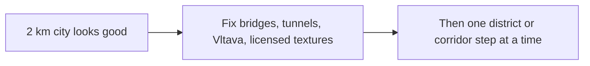

# Larger Praha, open tunnels, a visible Vltava

The playable city on Heroku release v4 is still a **2 km** circle around Staroměstské náměstí (`radiusMetres: 2000` in the committed [PragueGTA/cities/prague/city.json](PragueGTA/cities/prague/city.json)). That city otherwise looks quite good. Do not rebuild it from scratch, and do not replace it with one 6 km bake.

Extent is `radius × 1.25`. A disk that also reaches the airport, Černý Most, and Chodov/D1 would be about **12 km** across the origin — on the order of 30× the current area. `mobility.json` is already ~20 MB; that scale blows past GitHub’s 100 MB file limit, Overpass, the IPR download, and the Heroku slug.

## Next, from play feedback

In this order:

### 1. Bridges and tunnels drive wrongly

This is not only “add the missing tunnels”. Bridges and tunnels already in the 2 km city behave strangely while driving. Inspect how bridge and tunnel ways are meshed, elevated, and collided, including the tram passage under the house by Karlovy lázně. Fix that driving. Do not fill tunnels with water.

Keep `tunnel=yes`, `tunnel=building_passage`, and `covered` ways in the road graph. Draw a passage slightly below the street and omit building collision in that volume so the house does not seal it. Water must not flood the volume.

### 2. The Vltava still does not read as a river

The channel-and-surface fix stays. [PragueGTA/src/terrain-mesh.js](PragueGTA/src/terrain-mesh.js) draws a full terrain grid; the river has to sit in a channel cut out of that grid, at the mapped water level from [PragueGTA/scripts/city-terrain.mjs](PragueGTA/scripts/city-terrain.mjs), with the existing animated surface in [PragueGTA/src/sea.js](PragueGTA/src/sea.js).

Also accept `waterway=river` / `waterway=riverbank` relations so the Vltava channel is a polygon even when OSM stores it as a centreline. Add a short CC0 water loop in [PragueGTA/src/audio.js](PragueGTA/src/audio.js), heard only near water, and a few simple ducks or geese that swim on the river polygons. Gulls stay a Helsinki scene.

### 3. Real Prague textures

Photo textures were deferred. They are in scope now. Source textures that are actually licensed for this game: IPR Praha, OpenStreetMap, a Creative Commons licence, or photos the user supplies. Apply them to streets, quays, and building faces. Do not invent stand-in photographs, and do not scrape copyrighted photos.

### 4. Later growth, one playable step at a time

The 2 km city is the base. Later district and corridor growth stays on branch `city/prague-wide`. One modest radius step for the nearest missing districts (measure first; Prague 1–2 plus the closest of Vltavská, Holešovice, Karlín, Smíchov, and Dejvice). Only after that step is playable: Troja, Kobylisy, and Bohnice if they did not fit, then one corridor at a time (tunnel chain plus Jižní spojka, Magistrála toward Chodov, Severní spojka, the airport road). Never one 6 km leap. A failed Overpass query must not delete the last good `public/cities/prague`.

## Inner districts, measured, then one step

When growth starts, measure these points in local metres from `[14.42125, 50.08747]` and pick the smallest next circle, not the circle that contains every name at once:

- Prague 1 and Prague 2 (whole districts)
- Vltavská, Holešovice, Karlín, Smíchov, Dejvice / Hradčanská
- Troja, Kobylisy, Bohnice
- Trojský most and Barrandovský most, if they still fall inside that step

[PragueGTA/scripts/city-build.mjs](PragueGTA/scripts/city-build.mjs) must keep the previous packs until the new step validates, then swap. If `mobility.json` or any other file approaches 90 MB, thin walking edges and trees outside the old 2 km core before committing. Do not commit a file over 100 MB.

## Long roads as corridors

Do not fill the disk out to the airport. After the inner step is playable, add one buffered strip at a time (roads, a narrow band of buildings and terrain, playable area) for:

- The tunnel chain from Troja / Trojský most through to Barrandovský most, plus Jižní spojka
- Magistrála from Vltavská to Chodov / D1
- Severní spojka from Letňany to Černý Most
- The road from Dejvice to Václav Havel Airport

Reuse the engine’s extra playable area (`registerPlayableArea` in [PragueGTA/src/geo.js](PragueGTA/src/geo.js)). Helsinki’s [PragueGTA/scripts/build-extension.mjs](PragueGTA/scripts/build-extension.mjs) is the format reference; it is tied to Helsinki’s projection, so the Prague corridors get their own bake into `public/cities/prague/` rather than `public/data/extensions/`.

## Czech vehicles, as a coat of paint

The fleet is already procedural. [PragueGTA/src/police-model.js](PragueGTA/src/police-model.js) is a Finnish Octavia (blue and lime, “112”). For Praha, recolour that estate to a white Czech police car with a blue stripe, and bias ordinary traffic toward common Škoda body colours. Street, quay, and façade textures are the separate licensed-texture step above, not a paint job on the cars. IPR buildings stay LOD2 shells until a licensed texture is applied.

## Bonus: I. P. Pavlova, without a real person

A scripted moment on the Magistrála, driving from the museum through I. P. Pavlova: the player is in a black boxy off-roader, the driver model has one hand up, and a small ambulance pulls into the car. The driver is fictional. Do not name or likeness a real person. This can land with the first step that already contains the museum and I. P. Pavlova. Do not block it on the airport corridor.

## Ship

Commit each finished step on `city/prague-wide` only. Never commit on `main`, `master`, or `city/prague`. Leave Heroku release v4 (`d15b222`) until a finished step is worth deploying, and deploy only if the slug still fits. Hooks stay on. Do not commit secrets.
